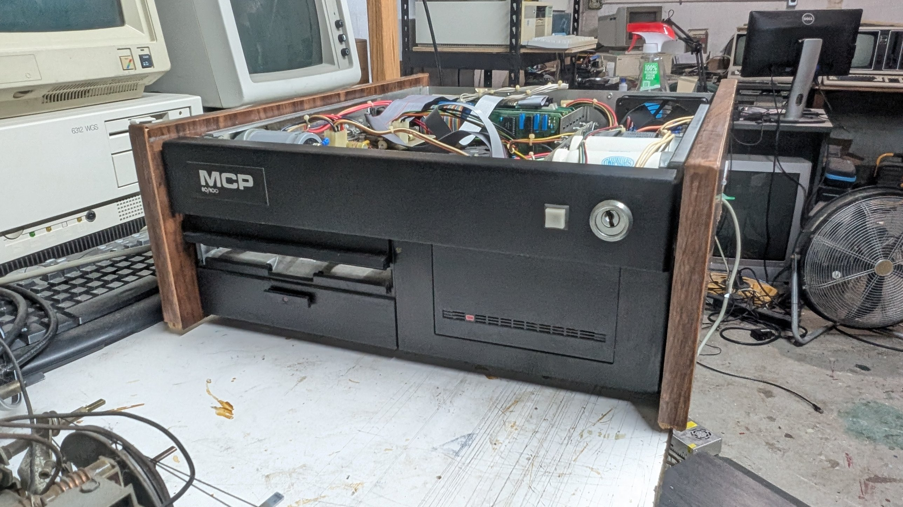

# MCP 80/100 restoration

Notes, dumps and tools for an early-1980s **MCP 80/100**: a Z80 S-100 machine
in a wood-sided case, with an 8" floppy drive and a MiniScribe MFM hard drive.

Very little about MCP is findable online. The only reference so far is one
line in a list of CP/M machines: *"MCP (128K, Z80, S-100 bus)"*. This unit
has a single 64K memory card, so that entry probably describes a fuller
configuration. The system software on its hard disk gives the full name,
**MCP Computer Products**: the floppy BIOS is headed with it, the hard
disk BIOS is "MCP COMPUTER PRODUCTS CONFIGURATION 12-01-82", and the
floppy formatters were modified by Jim Yates of MCP Computer Products in
1980 ([disk/original-system/](disk/original-system/README.md)).

## Status

| Area | State |
|---|---|
| Power supply | Caps reformed, load test passed. Floppy supply not yet checked |
| Boot ROM | Dumped (4 identical reads), fully disassembled, listing reassembles byte-for-byte |
| Replacement monitor (MCPMON 2.0) | **Running on the machine** (burned to a 2732, doubled image) |
| 8" floppy | **Reads and writes**: Shugart SA850 on MCP's FD1793 card, 361 rpm. FDTEST formats, writes and verifies single density; data also cross-checked with a Greaseweazle. Old double-density disks need erasing before formatting |
| MiniScribe hard disk | MiniScribe 4020: **working again** with a replacement firmware EPROM (bitsavers image, same board); **the original system boots from it** (MCPMON `L`). **Imaged** (2026-10-12, read twice through the machine's own controller with HDIMAGE): 377 files on A: and 211 on B:, all complete. Retired to the shelf, and not to go back on the XCOMP until its write-gate blips are fixed ([disk/](disk/README.md#faults-found-2026-10-13-to-16-with-the-emulator)) |
| Hard disk emulator | **The MCP boots the 1982 system from an EBAZ4205 FPGA board** emulating the MiniScribe (2026-10-16), the whole disk synthesised from the image ([disk/emulator-target.md](disk/emulator-target.md)) |
| XCOMP ST/S controller | Track format fully known (gray-mark hard sectoring, XOR check bytes). Gray-mark timer drift found and fixed; two data-board faults open: a lost last check bit, and 1.6 µs write-gate blips that damage a real drive's headers ([disk/xcomp_troubleshooting.md](disk/xcomp_troubleshooting.md)) |
| First power-up with cards | **Works** (CPU + memory card only): monitor prompt at 9600 baud |
| CP/M 2.2 | Bootable 8" disk built (60K, own BIOS); runs on the real machine from the SA850: boots with MCPMON's `B`; DIR, STAT, SAVE, PIP with verify and FDTEST all work. XM (XMODEM on port B) moves files both ways; Planetfall runs on the VT52 (Vezza, patched for a real VT52) |

## MiniScribe 4020 firmware

This machine's MiniScribe IV 4020 lost its firmware: the drive's MC6803 runs
from an OKI MSM2716AS EPROM at U20 (logic board P/N 3000708), and that chip
reads all zeros. Bitsavers has a dump from a drive with the same board
([`40216-12_2516.BIN`](http://bitsavers.trailing-edge.com/pdf/miniscribe/Miniscribe_4020/)); it checks out (vectors, 6803 code, its own
checksum and part number), and burned to a new chip it brought the drive
back. The firmware's power-up sequence, I/O map and LED error codes are in
[disk/README.md](disk/README.md).

## Quick facts

| | |
|---|---|
| CPU | Zilog Z80B on the MCP-1980 CPU card |
| RAM | One MCP 64K static card (32 × HM6116). Small scratch RAM below F400h, probably on the CPU card |
| ROM | 2716 monitor at F800h–FFFFh, no autoboot |
| Console | Rear port **A** (null modem cable), 8251 at ports 02h/03h, **9600 baud**, 8 data bits, no parity, 2 stop bits (an 8N1 terminal works). Baud rate from a COM5016, probably set by the CPU card's DIP switch |
| Floppy | Shugart SA850 8" drive on MCP's own FD1793 card at F8h–FBh (FCh = wait port) |
| Hard disk | MiniScribe 4020, ST-506 MFM, 480 × 4 × 32 × 256 bytes, on an XCOMP ST/S controller at 60h–66h |
| OS | Original: "62K MSIOS (16 Meg) / CP/M Vers 2.2 / 28-Oct-82" on the MiniScribe, two logical drives; now run from the emulator, sources in [disk/original-system/](disk/original-system/README.md). New: CP/M 2.2, 60K, own BIOS, boots from the 8" drive ([cpm/](cpm/README.md)) |

## Layout

| Path | Contents |
|---|---|
| [hardware/](hardware/README.md) | Boards, chips, chassis |
| [hardware/power-supply.md](hardware/power-supply.md) | PSU caps, reforming, rail measurements, load test |
| [rom/](rom/README.md) | ROM image, annotated disassembly, monitor reference |
| [rom/mcpmon/](rom/mcpmon/README.md) | MCPMON 2.0 replacement monitor, simulator, tests |
| [disk/](disk/README.md) | MiniScribe 4020 and its firmware, XCOMP ST/S controller and its track format, the original system, the image and what's on it; [xcomp_troubleshooting.md](disk/xcomp_troubleshooting.md): the controller's faults, with scope captures and schematic excerpts; [emulator-target.md](disk/emulator-target.md): the MFM emulator target and its status; [original-system/](disk/original-system/README.md): the system's own sources from the disk (XCOMP's MiniScribe software, MCP's floppy BIOS and formatters) |
| [photos/](photos/README.md) | Photos with captions |
| [cpm/](cpm/README.md) | CP/M 2.2 for the MCP: BIOS, boot sector, XM (XMODEM on port B), disk image build, simulator tests |
| [docs/](docs/README.md) | Datasheets and reference links |
| [tools/](tools/) | Helper scripts; [tools/addrtest/](tools/addrtest/README.md) memory card address-line test; [tools/drivetest/](tools/drivetest/README.md) hard disk exerciser (select, step, live status); [tools/hdimage/](tools/hdimage/README.md) hard disk imager (header layout probe, whole drive to the PC by XMODEM, drive tests, PC scripts to map, fix, merge and extract the image); [tools/mandel/](tools/mandel/README.md) ASCII Mandelbrot demo; [tools/portb/](tools/portb/README.md) serial port B test/bridge; [tools/fdtest/](tools/fdtest/README.md) 8" floppy test (live status and rpm, read, format/write/verify); `tools/bin2hex.py` makes HEX files for `H`; [tools/gwtest/](tools/gwtest/README.md) Greaseweazle bench test images for the 8" drive; `tools/tekwfm.py` decodes TDS420A `.WFM` scope captures (in [hardware/captures/](hardware/captures/)) |
| [ROADMAP.md](ROADMAP.md) | Plan and open questions |
| [LOG.md](LOG.md) | Work log |

## Not in this repository

- **The hard disk image** and the files on it: besides the system, they
  are the previous owners' personal and business records. Only the system
  side is documented here.
- Third-party software and scans, which are linked instead: Vezza
  (Z-machine interpreter, GPL), Infocom story files, RunCPM, the MiniScribe
  firmware image (bitsavers), the XCOMP ST/S manual and schematic (a few
  small excerpts of the schematic are in disk/xcomp_troubleshooting/), chip
  manuals, Digital Research's sample BIOS sources. See [docs/](docs/README.md), [disk/](disk/README.md) and
  [cpm/](cpm/README.md) for where they are.
- The emulator project (EBAZ4205 gateware, firmware and tools) and its
  track store, which is built from the private image.
- Build outputs: `python3 cpm/build.py` makes the CP/M disk image
  (`cpm/out/mcpcpm22.img`), fetching z80pack's CP/M 2.2 system files.

## Tools needed

`z80asm` (the GNU one, `apt install z80asm`) for the Z80 sources;
Python 3 with `pip install z80` for the simulator and the test suites;
`cpmtools` for the CP/M disk image; a Greaseweazle and Tera Term (or any
XMODEM terminal) for the real machine.

## Safety notes

- The PSU caps hold a lot of energy and there's no bleeder when nothing is
  connected. Discharge them through a 100 Ω, 5 W resistor before working
  inside. Never short them.
- Keep the MiniScribe disconnected during any experiment that could issue a
  write or format command to the hard disk controller.
- Don't connect the MiniScribe (or any real drive) to the XCOMP controller
  at all until its write-gate blips are fixed or blocked: they happen on
  reads too and overwrite header bits.
- Don't use the monitor's `B`, `A` or `L` commands until the drives are meant
  to be in use. `B` and `A` may hang waiting on the floppy controller.
- Don't read port FCh by hand: it's the floppy card's wait port and can
  stall the CPU until reset.
