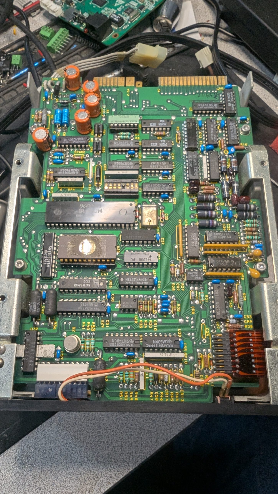
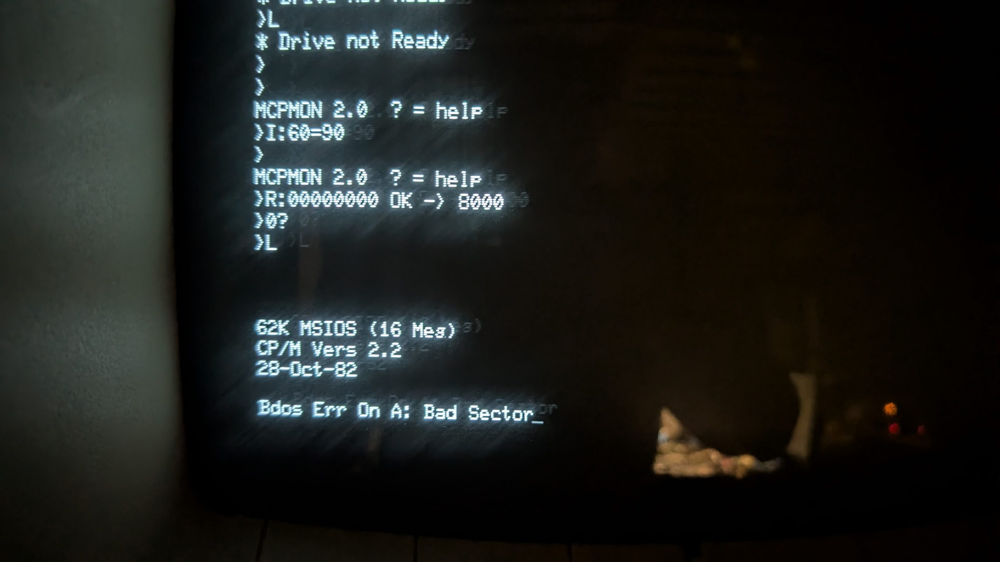
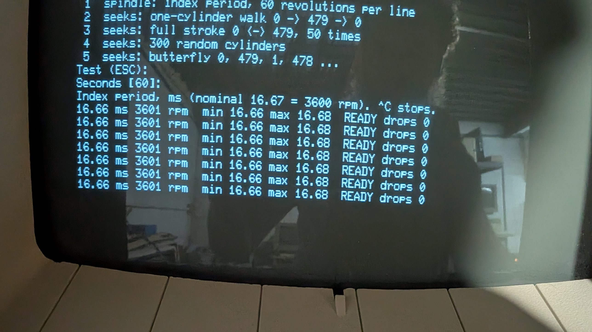

# Hard disk

## Drive

**MiniScribe IV, model 4020**: 5.25" full height, ST-506 interface (MFM).

| | |
|---|---|
| Cylinders | 480 |
| Heads | 4 (2 platters) |
| Capacity | 20 MB unformatted; 15.7 MB formatted as 32 × 256-byte sectors per track, which is the XCOMP format |
| Speed | 3600 rpm; 18 ms track-to-track, 133 ms average access |
| Power | +5 V 1.0 A typical; +12 V 1.5 A typical, **4.5 A start surge for about 5 s** |

Source: [MiniScribe 4020 brochure](https://ftp.mirrorservice.org/sites/www.bitsavers.org/pdf/miniscribe/brochures/Miniscribe_4020_Brochure.pdf) (bitsavers).



**Drive electronics:** logic board P/N 3000708, Motorola MC6803 (no
internal ROM) running from an external **OKI MSM2716AS EPROM at U20** (window
uncovered, label missing), 74LS373 address latch, terminator RP1 (220/330,
socketed), drive-select DIP shunt at E1.

**Jumper block E1** (16-pin DIP shunt; CLOSED = shorted), from the
[stason.org 4020 page](https://stason.org/TULARC/pc/hard-drives-hdd/miniscribe/M4020-17MB-5-25-FH-MFM-ST412.html):

| Pins | Function |
|---|---|
| 8–9 | DS1 |
| 7–10 | DS2 |
| 6–11 | DS3 |
| 5–12 | DS4 (close only one DS pair) |
| 1–16 | Closed = radial (signals always enabled; LED only when selected), open = daisy chain (signals only when selected) |
| 2–15 | Closed = normal ready; open = firmware exerciser (seeks to shipping zone, then random seeks for about 5 days) |
| 3–14, 4–13 | Track zero phasing, factory set: don't change |

Factory default: all pairs shorted. Terminator pack (220/330 Ω) sits next to
the shunt block; it belongs only on the last drive of a chain.
This drive's E1 configuration (photo: `photos/miniscribe-e1-shunt.jpg`):
**8–9 closed (DS1), 2–15 closed (normal ready)**; everything else open:
DS2–DS4 open, 1–16 open (daisy chain), and both track-zero phasing pairs
(3–14, 4–13) open, which is the factory calibration for this drive, so
leave them as found. The jumpers are correct for a single drive on DS1; they
aren't the reason the drive doesn't work.

**Status (2026-10-09): drive firmware lost.** The U20 EPROM reads all 00h in
the programmer (several reads, setup confirmed by reading the MCP boot ROM
correctly). At power-up the spindle starts but the heads never recalibrate,
the drive never becomes ready and never answers select. A replacement 4020
firmware image is needed before the drive can be read at all.

**Firmware found (2026-10-11):** bitsavers has a dump of a 4020's EPROM,
[`40216-12_2516.BIN`](http://bitsavers.trailing-edge.com/pdf/miniscribe/Miniscribe_4020/) (a TI 2516, the 2716 equivalent), with photos of
the drive it came from: logic board **P/N 3000708-01**, the same board as
this one. Checked here:

| Check | Result |
|---|---|
| Size | 2048 bytes (2716) |
| SHA-256 | `0c15f53b38a9a33c0d6b782c570819f0dd85591e362cc676461a662caddfa69a` |
| Vectors (last 16 bytes, 6803 order) | RESET 1800h; output compare 1EB6h, input capture 1E38h, SWI 1EE4h; unused ones 1800h. All inside the EPROM, which the 6803 sees at 1800h-1FFFh (and mirrored at the top for the vectors) |
| Code at 1800h | Valid 6803 start-up: SEI, timer and port 1/2 set-up, stack at 00FEh, then a test of the internal RAM (0080h-00FFh) |
| Part number in the image | Bytes 7EBh-7EEh: 04 02 16 12, i.e. 40216-12, matching the label |
| Checksum | Byte 7EFh makes the 8-bit sum of all 2048 bytes 00h |
| Unused space | 7A6h-7EAh zero |

**Status (2026-10-11): drive working again.** Burned to a new chip in U20,
the drive spins up, recalibrates and goes idle; selected on the bench (DS1,
J1 pin 26, to ground) the front LED lights. The original chip stays
labelled and kept.

What a healthy power-up looks like on the bench, unselected: spin-up, a
short burst of steps (recalibrate from near track 0 is only 15-20 steps),
then a steady hum from the stepper, which stays powered to hold position.
The LED stays dark until the drive is selected. Track 0 (74LS244 pin 8)
reads high afterwards because the heads sit at track 0.

### What the firmware does (40216-12, disassembled)

The listing: [miniscribe_40216-12.info](miniscribe_40216-12.info) is the
[f9dasm](https://github.com/Arakula/f9dasm) info file (I/O and RAM labels,
the named routines, the data and vector ranges); with the bitsavers image,
`f9dasm -6801 -offset 1800 -info miniscribe_40216-12.info 40216-12_2516.BIN`
regenerates it. The image itself is linked, not copied.

The 6803 runs in expanded mode: internal registers at 0000h-001Fh, internal
RAM 0080h-00FFh, the EPROM at 1800h-1FFFh (also seen at F800h-FFFFh, where
the vectors and the checksum loop find it), and external I/O decoded at
0040h-0047h. The image ends with "Copyright (c) 1982 MINISCRIBE Corp".

**Inputs and outputs**

| Where | Bit | Use |
|---|---|---|
| Port 1 P10 (6803 pin 13) | 0 | ST-506 DIRECTION IN |
| Port 1 P11 (pin 14) | 1 | Step-pulse flag, set and cleared through 0040h/0041h |
| Port 1 P14 (pin 17) | 4 | E1 4-13, track 0 phasing (open = high) |
| Port 1 P15 (pin 18) | 5 | E1 3-14, track 0 phasing (open = high) |
| Port 1 P16 (pin 19) | 6 | **E1 2-15: low = normal, high = exerciser** |
| Port 1 P17 (pin 20) | 7 | Drive select |
| Port 2 P20 (pin 8) | | Index pulse (timer input capture: spindle speed) |
| Port 2 P21 (pin 9) | | Spindle motor drive (timer output compare, speed regulated every revolution) |
| Input 0046h | 0-5 | Count of host step pulses (external counter, cleared through 0043h) |
| Input 0046h | 6 | **Track 0 sensor** (1 = at track 0) |
| Input 0046h | 7 | Latch checked at power-up (cleared by a read of 0042h) |
| Output latch 0045h | 0 | Set once the spindle is up |
| | 1 | Ready |
| | 2 | Stepper direction (1 = out, towards track 0) |
| | 3 | Step pulse |
| | 4, 5 | Stepper drive (set while seeking) |
| | 6 | Seek complete |
| | 7 | Front LED (lit when selected; blinks error codes) |

**Power-up:** internal RAM test, EPROM checksum, a check of the step-pulse
logic and the 0046h latch, spindle start (index pulses measured on P20 until
the speed is right), then recalibrate:

1. Step in (up to 40 steps) while the track 0 sensor is on.
2. Step out, about 1 ms per step, until the sensor comes on (up to 1130
   steps). Step delays assume an E clock near 1 MHz.
3. Step in 3, then out slowly (about 20 ms per step) until the sensor comes
   on again. **No step limit and no LED code here**: if the sensor isn't
   seen again, the drive creeps outward forever with the LED dark.
4. Step out slowly until the stepper phase matches the phasing jumpers
   (P15 low adds 4, P14 low adds 2; both open = phase 0).

It then waits for the spindle speed to lock and reads E1 2-15 (P16): low
gives normal operation (ready, waiting for select and step pulses); high
starts the **exerciser**: two blink codes 1100-1111 (the low bits show the
track 0 phase it found), a seek to the shipping zone with the LED on, then
a recalibrate and random seeks that go on for days.

**LED codes:** after a pause, four blinks, most significant bit first:
short = 0, long = 1. Fatal ones repeat forever and the drive stops.

| Code | Meaning |
|---|---|
| 0000 | Internal RAM test failed (fatal) |
| 0001 | EPROM checksum wrong (fatal) |
| 0010 | Step-pulse logic self-test failed (repeats, retrying) |
| 0011, 0100 | Latch at 0046h bit 7 wrong at power-up (repeats) |
| 0101 | No index pulses at spin-up (fatal) |
| 0110 | Spindle didn't reach speed (fatal) |
| 0111 | Speed not locked (fatal at start-up; later, speed lost, restarts after a while) |
| 1000 | Track 0 sensor stays on after 40 steps in (fatal) |
| 1001 | Track 0 not found after 1130 steps out (fatal) |
| 1010 | Track 0 phasing off: 0-1 or 6+ steps to the jumpered phase (shown once, carries on) |
| 1011 | Selected and stepped, but no step pulses counted (shown once) |
| 11xx | Exerciser start (shown twice), xx = track 0 phase found |

The handling label on top includes the factory defect list: **cylinder
345 head 0, 2536 bytes from index; cylinder 342 head 0, 6941 bytes from
index** (about slots 8 and 21 of 32 at 10,416 bytes per revolution).
Neither track has a bad sector in either image: the formatter skipped the
defective slot and the track's 33rd sector — the "sector 32" every track
answers to — took its place. That is what the spare is for.

Keep the drive **unplugged** until it can be imaged. It may hold the
original OS and software, so don't boot from it first: booting can write to
it.

## The original system on the drive (first boot 2026-10-11)



MCPMON `L` boots it. Sign-on:

```
62K MSIOS (16 Meg)
CP/M Vers 2.2
28-Oct-82
```

So: CP/M 2.2 in 62K with a BIOS called MSIOS ("MiniScribe I/O System"),
"16 Meg" for the whole 4020, split into two logical drives (see the image
results below: CP/M 2.2 can't address more than 8 MB per drive). The
first `DIR` of A: (read with bad directory sectors, see below):

| Kind | Files |
|---|---|
| The system's own sources and tools | MSBOOT.ASM, MSBOOT.HEX, MSIOS1.HEX, MCPBIOS.HEX, MSGET.ASM, MSPUT.ASM, MSPUT.COM, MSRDT.ASM, MSATS.ASM, MSATS.HEX, MSMDC.HEX, MSOFF.COM, DFORMAT.ASM, DEBLOCK.ASM, DISKDEF.LIB, CPM62.COM, QPARM.COM, QPARM.SSG, EXEC.COM |
| CP/M | MOVCPM, DDT, SUBMIT, XSUB, ASM, LOAD, STAT, SYSGEN, DUMP (.COM and .ASM), MAC |
| Applications and data | WordStar (WS, WSU, WSMSGS.OVR, WSOVLY1.OVR, MAILMRGE.OVR), CANCELS.CMD and MAIL.DBF (dBASE II?), FPM.BAS, FPM.REL, BILPR.REL, QSORT.COM, EXAMPLE.TXT |

DFORMAT.ASM (the formatter) and the MS*.ASM files should document the
sector header layout, the controller programming and the bad-track
handling (MSATS: alternate tracks?) directly.

The full `DIR` runs to several hundred files. Besides the system files
above there are more system tools (MSBT, MSFMT, FORMAT, DFORMAT.COM, and
CRC.COM with a CRCKLIST.CRC, a checksum list that will help verify files
extracted from the image), dBASE II (DBASE.COM with many .CMD programs and
.DBF files), MBASIC programs in source and compiled form (.BAS, .REL, .COM),
and a great deal of the previous owners' own work: letters, accounts and
similar personal and business records. **The image and those files stay
out of this public repository**; only the system side gets documented.

**Read errors:** "Bdos Err On A: Bad Sector" at the first prompt (the CCP
searching the directory) and once during `DIR`. After that error DIR
repeated the 7 entries before it (QPARM.COM ... MSATS.HEX): CP/M reused the
previous directory sector's buffer, so one 256-byte directory sector (up to
8 entries) didn't read. It could be a real defect, or the marginal cable
connection found the same evening (the read data travels on the 20-pin
cable). The full listing hit about ten such errors, some two in a row, each
followed by repeated entries: more than scattered defects would explain,
so something systematic (the cable, the controller's data separator,
head positioning, or one weak head) is as likely as worn media. HDIMAGE's
list of failing C/H/S will show which: one head, one sector position on
every track, certain cylinders, or random. To be imaged with retries
before anything else.

**Sector header layout (2026-10-12, HDIMAGE's probe on the real drive):**
byte 0 = cylinder bits 0–7, byte 1 bit 0 = cylinder bit 8, byte 2 = head,
byte 3 = sector; the boot sector C0 H0 S0 is `00 00 00 00`, as the ROM
assumes. The seeks by seek count work as the manual says. The first probe
of the day was fooled by the drive's dropouts (READY and DRIVE SELECTED
flicker, cable), which also made `R` fail with error 80 later; HDIMAGE now
checks the drive status after every read and confirms what the probe
finds with a second read ([tools/hdimage](../tools/hdimage/README.md)).
New cables (the old edge sockets were loose) cured the dropouts that
fooled the probe. What is left (seen during the full image run): READY
drops for a moment now and then, at cylinder and head changes, with the
LED blinking **1 fast, 3 slow = firmware code 0111, spindle speed lock
lost and regained**. That is the drive itself: the firmware times the
index pulses and drops READY while the speed is out of tolerance. Suspects
are the +12 V sagging under the stepper's seek current, the spindle motor
or its driver, and the index sensor; the test is the drive on a bench
supply. HDIMAGE rides the events out (waits, restores, re-reads).

**What is on the disk and what is wrong with it (cylinders 0-1 imaged,
2026-10-12; the full images confirmed it):** one 8K track per head (32 sectors of 256 bytes), two
reserved tracks — C0 H0 holds the boot sector, CCP/BDOS and the MSIOS
BIOS (sign-on in sector 23), C0 H1 is empty (E5h) — then a 4-track
directory of 1024 entries from C0 H2 (used through C1 H0 sector 4), and
data from C1 H2. All 13 bad sectors of those two cylinders are `02` (ID
not found, no CRC flag) and all are on the directory tracks: 10 on C0 H2,
2 on C0 H3, 1 on C1 H0 (in the unused part of the directory); the system
track and the first data track read clean. The same errors the original
system hit in `DIR`. The ID fields were written once, at the 1982 format,
and never again; the directory's data fields are rewritten on every file
close. HDIMAGE's `F` hunts for those sectors under every one-bit and
one-byte variant of their ID ([tools/hdimage](../tools/hdimage/README.md)).

## The image (2026-10-12)

The whole drive was read twice through the XCOMP with
[HDIMAGE](../tools/hdimage/README.md) — once in the afternoon (about 3 h,
202 bad sectors) and once cold in the evening, with a later build — then
`F` over the bad list and `hdfix.py`, and `hdmerge.py` to combine the
reads. **The image itself is not in this repository**: it holds the
previous owners' personal and business files.



| | |
|---|---|
| Geometry | 480 cylinders × 4 heads × 32 sectors × 256 bytes, 8K per track, 15,360K |
| Sector ID | cylinder low, cylinder high (bit 0), head, sector |
| Spare | every track also answers to sector number 32: the formatter's defect slip (both factory defects, C342 H0 and C345 H0, sit on tracks that read 32 good sectors) |
| A: | 2 reserved tracks (C0 H0: boot sector, CCP/BDOS, MSIOS; C0 H1: empty), directory C0 H2–C1 H1, 1024 entries, 4K blocks, data from C1 H2; 452 entries used, 3,344K allocated |
| B: | directory from C240 H2 (track 962), 1024 entries, 4K blocks; 238 entries used, 1,592K allocated, highest block at cylinder 291 |
| Leftovers | directory-shaped single tracks at C421 H2 and C456 H3 whose block numbers point past the disk: remains of an earlier partitioning, in B:'s free space |

**Result:** with `hdextract.py`, **377 files on A: and 211 on B:, none
with a bad sector in it.** What could not be read is A:'s directory
damage — about 14 directory sectors whose ID fields answer to no one-bit or
one-byte variant, so whatever entries they held (files deleted or not) are
not in the listing — and scattered single sectors, none of them inside a
file. The first
`F` pass also showed that the controller matches a "sector 32" on every
track; HDIMAGE and `hdfix.py` now refuse such hits (see the HDIMAGE
README).

**The drive's health:** the directory tracks got worse over the day (14
bad cold in the morning, 25 warm, 24 cold again in the evening), so they
are not to be hammered any more: the flux-level read is the only tool
left for them. READY dropouts (LED code 0111, speed lock lost; now and then
a full spin-down and restart) happen while *reading*: the spindle measures
3601 rpm, 16.66–16.68 ms, with no drop at idle, cold or after three hours,
and the seek tests (`T 2`–`T 5`, far more stepping than imaging) run clean.
Suspects: the index sensor or its line picking up noise from the read
electronics, or a supply dip under read load (the +12 V feeds the read
preamp). Test: a few cylinders of `I` on a bench supply with a scope on
INDEX and +12 V. Otherwise the drive is retired to the shelf; its job now
is to be the raw-track reference for the [MFM emulator target](emulator-target.md).

**Run the files:** RunCPM (<https://github.com/MockbaTheBorg/RunCPM>) runs
them on a PC with folders as drives; WordStar and dBASE are installed for
the VT52, so their full-screen modes need a VT52-capable terminal. On the
real machine, a cpmtools image in the `ibm-3740` format (as
[cpm/](../cpm/README.md) builds) puts them on an 8" disk.

## Controller: XCOMP ST/S (ports 60h–67h)

Not an MCP design: it's the **XCOMP ST/S** two-board ST-506 controller
(XCOMP Inc., San Diego).

- **XS data board**, 001785-1, serial 12776: S-100 side, microprogrammed
  sequencer with writable control store, 256-byte data buffer.
- **STS interface board**, "SA1000/ST506 INTERFACE" 001790-04, serial
  12777: drive side, with the data separator (trimmers: **don't touch**,
  they're the separator's calibration) and the port-address DIP switch at
  location G2.
- The two boards are joined by a ribbon cable; the drive's 34-pin and 20-pin
  cables plug into the interface board.

Documentation (s100computers.com):
[product page](https://s100computers.com/Hardware%20Folder/XComp/Hard%20Disk%20Controller/XCOMP.htm),
[ST/S Users Manual](https://s100computers.com/Hardware%20Manuals/XComp/HDC%20Manual.pdf),
[schematic](https://s100computers.com/Hardware%20Manuals/XComp/HDC%20Schematic.pdf).
The manual is written for a 153-cylinder ST-506; the register interface is
the same for the 4020.

### Register map (from the manual)

| Port | Out | In |
|---|---|---|
| 60h (BASE+0) | **Drive commands:** bit 0 SEEK (step by the seek count), bit 1 ENABLE INTERFACE (keep set) | **Drive status:** bit 0 READY, 1 WRITE FAULT, 2 TRACK 00, 3 SEEKING/ (low = seeking), 4 DRIVE SELECTED/ (low = selected), 5 INDEX (latched), 7 SEEK END |
| 61h (BASE+1) | **Extended drive commands:** bit 0 DRIVE SELECT, 1 DIRECTION = IN, 2–4 HEAD SELECT (0–7), 6 INHIBIT PRE-COMPENSATION, 7 REDUCE WRITE CURRENT | Clear index latch (data meaningless) |
| 62h / 63h | **Seek count**, 9 bits: LSB / MSB | |
| 64h (BASE+4) | **Controller commands:** bit 0 BANK1, 1 DATA BUFFER ENABLE, 2 COMPARE BUFFER ENABLE, 3 START (runs the microcode). Any write clears DELAYED INDEX and SECTOR | **Controller status:** bit 0 DONE, 1 BUSY (BUSY with DONE = sector not found), 2 COMPARE ERROR, 3 CRC ERROR, 4 DELAYED INDEX, 5 SECTOR, 6 SEEK END |
| 65h | **Buffer address** (write only) | |
| 66h | **Data out:** into BANK0, BANK1, data buffer or compare buffer, auto-increment | **Data in** (first read after selecting is a dummy) |

What the boot ROM does, in these terms:

- **Table A** goes to BANK0 = **read microcode**, starting at D7h.
  **Table B** goes to BANK1 = **write microcode**, starting at D3h. The ROM
  never runs the write microcode.
- The "4-byte target ID" is the **compare buffer**: the controller checks
  each sector header against it (cylinder, head, sector) before transferring
  data. Byte order not yet known.
- 61h = 41h: drive select + inhibit precompensation (the manual says keep
  bit 6 clear, but MCP's ROM sets it; harmless for reads). Restore uses 01h:
  drive select, direction out.
- Restore: seek count 01FFh, 60h = 03h (SEEK + ENABLE INTERFACE), wait for
  TRACK 00.
- Read: 64h = 08h runs BANK0 microcode from the buffer address; then 64h =
  02h and 256 reads from 66h.

**Safety:** never write 64h with bit 3 set yourself. 08h starts the read
microcode, which is harmless with a valid setup; **09h starts the write
microcode** and writes to the disk.

Port address: DIP switch at G2 on the interface board, switches 1–5 = address
bits 7–3 (ON = 1), switch 7 must be ON, switch 6 unused. For 60h:
1 OFF, 2 ON, 3 ON, 4 OFF, 5 OFF.

### Format

32 sectors of 256 bytes per track, separate header and data fields, each
with sync and check characters (2-byte check on the header). For the 4020:
480 × 4 × 32 × 256 = **15.7 MB**.

## Bench checks (2026-10-08, no drive connected)

| Test | Result |
|---|---|
| `I:60` (status) | `30`: everything inactive, as expected with no drive. Bit 4 = DRIVE SELECTED/ and bit 5 = INDEX (see register map) |
| Data buffer: `O:64:02 O:65:00`, write 11 22 33 to 66h, reselect, read 66h ×4 | `00 11 22 33`: buffer RAM works, pointer auto-increments, first read after selecting is a dummy |
| `R:00000000` | `* Drive not Ready`, as expected |
| Table A readback: `O:64:00 O:65:D7`, read 66h ×3 | `00 40 41`: BANK0 microcode RAM stores the table, same dummy read |

So the bus interface, data buffer and microcode RAM all work.

## Microcode tables

`tools/decode_hd_tables.py` prints them from the ROM image. Format: first
byte → 64h, second → 65h, then records: `n` (01h–7Fh) = n literal bytes,
`80h+n` = next byte repeated n times, `00h` = end. All data goes to 66h.

Table A (64h = 00h → BANK0, read microcode, start D7h):

```
40 41 | 3x40 | 12x6D | 63 | 4x65 | 2x67 | 49 | 2x40 | 12x6D | 63 E7 67 | 7x0F |
40 41 | 3x40 | 12x6D | 63 | 2x65 | 2x60 | 2x67 | 0F
```

Table B (64h = 01h → BANK1, write microcode, start D3h):

```
40 41 | 3x40 | 12x6D | 63 | 4x65 | 2x67 | 49 40 | 17x50 | 5B DD 5D 50 0F
```

The manual doesn't document the microcode word format; the schematic should.
The shapes still fit a sector: runs of 12 for sync fields, 4 for the header
compare, 2 for check bytes. The track format is defined by this microcode,
so an off-the-shelf flux decoder won't know it; reading through the
controller avoids the problem.

## Plan

Done: the drive was read through the machine's own controller with
[HDIMAGE](../tools/hdimage/README.md), which decodes the controller's own
format, and the files were extracted (`hdextract.py`, see above).

Next: an MFM (ST-506) target for the EBAZ4205 ESDI emulator, which would
let the MCP run the 1982 installation from the image, and whose reader
mode is the flux-level read for the sectors the controller can't find.
What the controller expects of a drive, the cabling and the test bench are
in [emulator-target.md](emulator-target.md).

Alternative: David Gesswein's MFM reader/emulator
(<https://pdp8online.com/mfm/>), which captures raw transitions from almost
any ST-506 drive and can also emulate one.

If the drive is spun up again:

- Run it cold and on a bench supply, not the machine. The 4020 pulls up
  to 4.5 A on 12 V for about 5 s at spin-up, so the supply needs to deliver
  that without current-limiting. Tie its ground to the machine's ground
  before connecting the data cables.
- Park it with HDIMAGE's `K` before powering down.
- Don't write to it until a raw capture exists: a low-level format would
  end the last chance at the damaged directory sectors.

