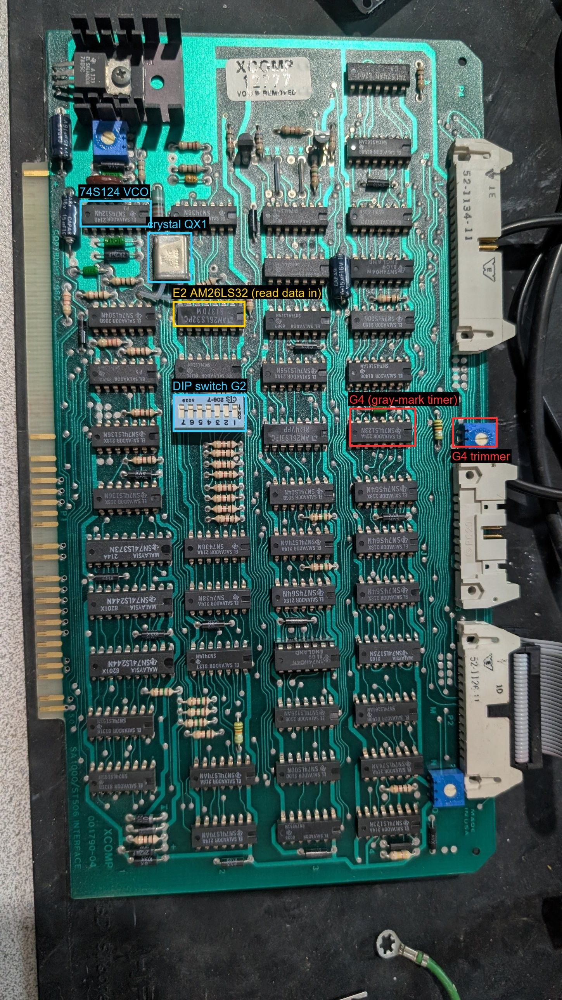
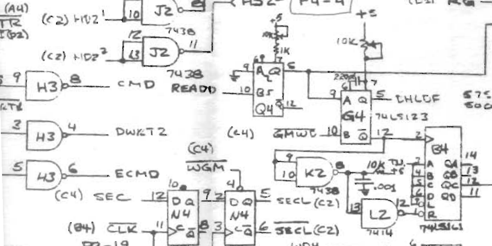
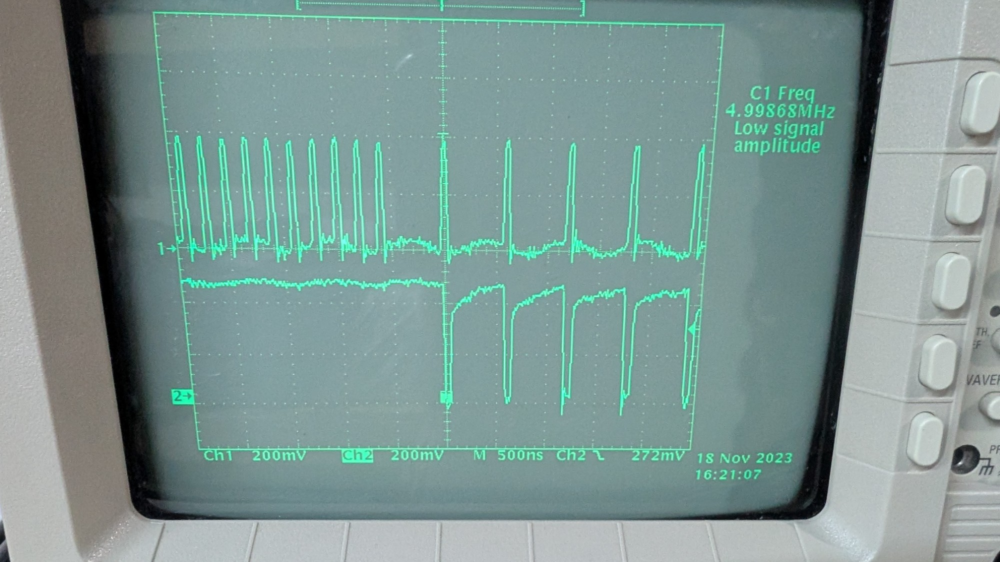
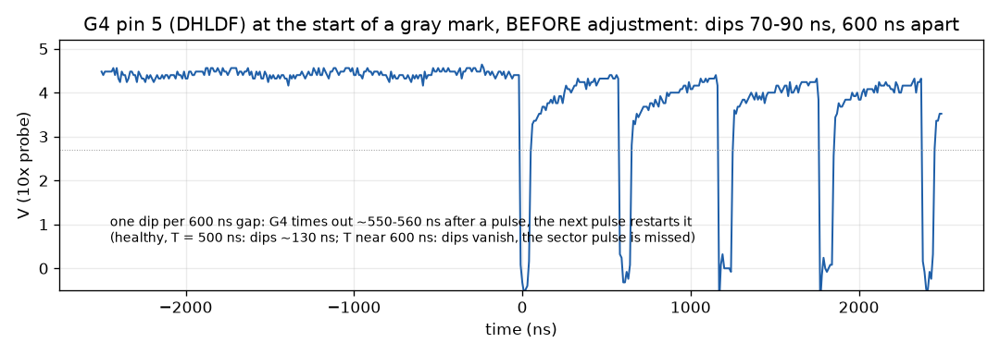
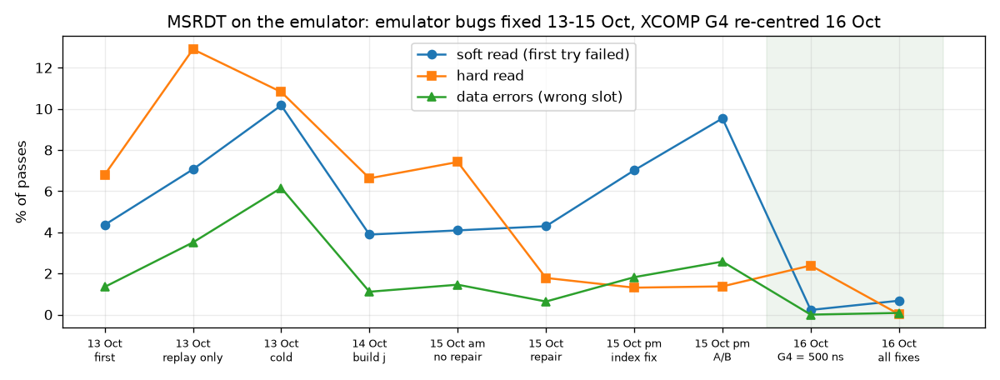
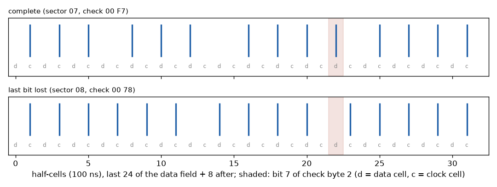
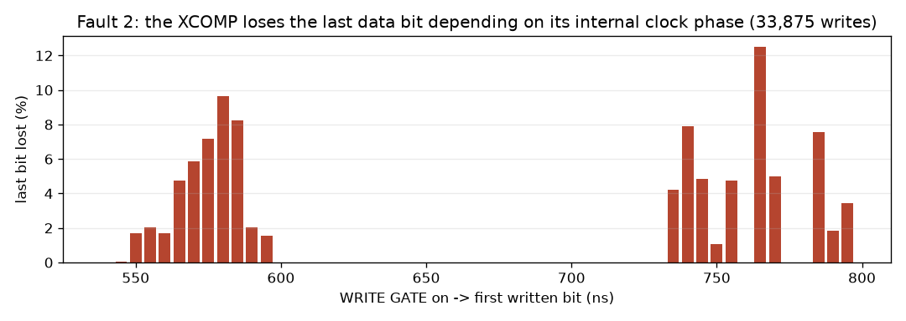
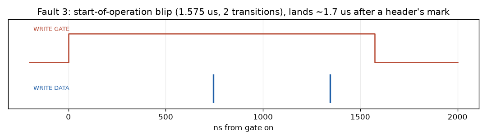

# XCOMP ST/S hard disk controller: troubleshooting summary

MCP 80/100 (S-100, CP/M 2.2) with an XCOMP ST/S controller (two boards) and a
MiniScribe 4020 (480 cylinders x 4 heads x 32 sectors x 256 bytes, 3600 rpm).
Work done 2026-10-12 to 2026-10-16, using an EBAZ4205-based ST-506 drive
emulator (record-and-replay gateware) as the test instrument in place of the
MiniScribe. This file is self-contained; detailed day-by-day notes are in the
ESDI_emulator project (`docs/mfm_target_notes.md` sections 6-22,
`docs/xcomp_fault_hunt.md`; not published yet). The controller's register
map and the rest of the hard disk notes: [README.md](README.md); the
emulator target: [emulator-target.md](emulator-target.md).

## Outcome in one paragraph

The controller had one adjustable fault and two hard faults. The adjustable
one, the gray-mark (sector) timer G4 on the interface board drifted to ~560 ns
instead of 500 ns, caused temperature-dependent read failures (4 % of first
read attempts cold, 7-10 % warm) and writes landing in the wrong sector slot;
re-centring its trimmer fixed both. The two hard faults are on the data board
and still present: the controller loses the last bit of a data field in 5-8 %
of writes, and it pulses WRITE GATE for ~1.6 us at the start of operations
(reads included), which on a real drive overwrites header bits. The emulator
works around both, and CP/M 2.2 now boots and runs from the emulator. The real
MiniScribe must not be connected to this XCOMP until the gate blips are fixed
or blocked.

## The hardware

| Board | Marking | Content |
|---|---|---|
| XS data board | XCOMP 001785-1, sticker 12776 | S-100 side: bus buffers, microcode sequencer (writable control store, banks 0/1), 256-byte data buffer, compare buffer. Drawn as a black box ("DFM-360 disk controller") in the schematic |
| STS interface board | XCOMP "SA1000/ST506 INTERFACE" 001790-04, sticker 12777 | Drive side: AM26LS32 receivers, AM26LS31 driver, crystal oscillator, write precompensation, gray-mark (sector) detector, 74S124 data separator, three trimmers, port DIP switch at G2 |

Documents: ST/S Users Manual (register map only, no adjustment procedure) and
the interface board schematic (drawing 001790 rev 3; the MCP's board is rev
04, a few parts differ, e.g. 74H04 in the precomp delay):
https://s100computers.com/Hardware%20Manuals/XComp/HDC%20Manual.pdf
https://s100computers.com/Hardware%20Manuals/XComp/HDC%20Schematic.pdf
(local copies: ESDI_emulator `ref/docs/xcomp/`). Board locations are a grid:
row letters A-N from the top (no I) with the gold fingers on the left, column
numbers 1-4 from the gold fingers to the connectors (the manual's DIP switch
"G2" confirms it).

I/O at base 60h on the MCP (MSRDT.ASM's source default is 70h: assemble it with
CBASE=60H). Status bits, from the manual:

- Drive status (BASE+0): 0 READY, 1 WRITE FAULT, 2 TRACK 00, 3 SEEKING/,
  4 DRIVE SELECTED/, 5 INDEX (latched), 7 SEEK END.
- Controller status (BASE+4): 0 DONE, 1 BUSY (with DONE = sector not found),
  2 COMPARE ERROR, 3 CRC ERROR (data, or headers when not found), 4 DELAYED
  INDEX, 5 SECTOR, 6 SEEK END.
- So MSRDT's "Cst=33" = sector not found, "Cst=39"/"29" = CRC error,
  "Cst=21"/"31" = success; "Dst=8D" / "Cst=6x/7x" just carry SEEK END.

*Interface board (gold fingers left, connectors right): G4 and its trimmer,
E2 (read data receiver), the DIP switch at G2, the crystal and the 74S124 VCO.
The data board is in `xcomp_troubleshooting/board_xs_data_001785-1.jpg`.*

## The disk format (measured from the controller's own writes)

- 5 Mbit/s MFM. Hard-sectored by **gray marks** the formatter writes: 8 flux
  intervals of 600 ns (MFM-illegal: MFM never exceeds 400 ns). First mark
  437 us after index, one slot every 504.1 us (5040-5041 half-cells of
  100 ns), 33 slots per revolution; slot 32's data field straddles the index.
- Header: zero sync (~138 clock transitions), mark (data bits 1111), 4 ID
  bytes (cylinder low, cylinder high, head, sector), 2 check bytes.
- Data field: zero sync, mark, 256 bytes, 2 check bytes, then a short zero
  pad; WRITE GATE rises 550-750 ns before the first transition and drops
  ~60 ns after the last. Bytes are serialised LSB first.
- **Check bytes are a 16-bit XOR**, not a CRC: byte 0 = XOR of the even bytes,
  byte 1 = 0xF0 XOR the odd bytes (data: bytes 0..255; header: the 4 ID
  bytes, e.g. ID 00 00 00 ss -> check 00, F0^ss). Verified on 19,582 data
  fields, including fields with stray single-bit errors where only the
  matching check bit changed.
- MSFMT interleave: skew 10 (SECTBL), slot 0 = the spare (logical sector 32),
  slots 1..32 = sectors 0,16,13,29,10,26,7,23,4,20,1,17,14,30,11,27,8,24,5,
  21,2,18,15,31,12,28,9,25,6,22,3,19. Sparing writes ID FF FF FF FF on the bad
  slot and moves the sector to the spare.
- Write precompensation is always applied (20 ns: each transition moved
  ~10 ns toward the shorter neighbouring interval); the "inhibit
  precompensation" bit made no difference.

## Fault 1 (fixed): gray-mark timer G4 drifted

**Symptoms.** With the emulator replaying bit-exact tracks: ~4 % of first
read attempts failed (MSRDT "soft read errors") in the morning, 7-10 % in the
afternoon; 0.6-2.9 % of writes landed in a random wrong slot (MSRDT "verify
errors" / "data errors": a read succeeds but returns another sector's
stamp). The same disk read worse warm during the original imaging of the
MiniScribe (25 bad directory sectors warm, 14 cold, nearly all "02 ID not
found").

**Circuit.** Each raw read pulse (E2 26LS32 pin 3, READD) is shaped by a
74LS123 one-shot (Q4, 1 k trimmer) and retriggers G4, a 74LS123 with a 10 k
trimmer and ~220 pF, designed for ~500 ns on the ST-506 (schematic note:
"575 nsec SA / 500 nsec ST"). MFM's longest gap is 400 ns and a gray mark's
gaps are 600 ns, so G4 only times out inside a mark; a 74LS161 counts the
timeouts into the SECTOR pulse (reset by a ~10 us RC). The whole hard
sectoring rests on that +/-100 ns window.

**Where.** G4 = row G, column 4: the SN74LS123N in the rightmost chip column
level with the DIP switch, next to the middle blue trimmer (its timing pot).
Pin 9 = trigger input (from Q4), pin 5 = DHLDF output, pin 8 = GND,
pin 16 = +5 V.

**Measurement.** Scope CH1 on G4 pin 9, CH2 on G4 pin 5, trigger on CH2
falling, the emulator replaying a formatted track (MCP sitting at an MSRDT
prompt is enough). Pin 5 sits high during data and dips low once per 600 ns
gap inside each gray mark. Dip width ~ 600 ns + ~30 ns (LS123 trigger delay)
- T. Measured dips 60-90 ns (70-90 ns at mid-level; Tektronix TDS waveform,
10 ns/sample) -> **T ~550-560 ns**, leaving ~40-50 ns before marks are
missed.

*Raw files: `xcomp_troubleshooting/TEK00004_g4_pin5_before.WFM` (Tektronix LLWFM, CH2,
10x probe with the channel set to 1x, so multiply volts by 10) and the same
as `.csv`.*

**Fix.** Trimmer turned (positions marked first) until the dips are
**130 ns** (T ~500 ns). Cleaning the trimmers alone (returned to their marks)
had changed nothing.

**Result.**

| Run (MSRDT2, emulator) | Passes | Soft read | Hard read | Data errors | Soft write |
|---|---|---|---|---|---|
| before G4, afternoon | 5976 | 9.5 % | 1.4 % (*) | 2.6 % | 1.6 % |
| after G4 | 880 | 0.2 % | (*) | 0 | 0 |
| after G4 + all emulator fixes | 4878 | 0.7 % | 0.02 % | 0.08 % | 0 |

(*) mostly sector 13, an emulator bug at the index fixed later. The residual
0.7 % soft reads are most likely reads that come back before the emulator's
firmware has repaired fault 2 in the stored track.

## Fault 2 (open, worked around): last data bit lost

**Symptom.** In 5-8 % of data-field writes the controller writes bit 7 of the
second check byte as 0 and starts its zero pad one cell early (stream ends
"1 [200] 1 [300] pad" instead of "1 [200] 1 [200] 1 [300] pad"). The rest of
the field is correct; the sector then reads with a CRC error until rewritten.

Proven at the controller's output: the emulator's raw pin samples and an
independent flux capture of the same write agree cycle for cycle.

**Not the cause:** data pattern (worst-case B6D9 fill 4.5-5.8 %, all-zero
fill 6.6 %), sector, slot, emulator timing grid, temperature (no clear
effect).

**Depends on:** the delay from WRITE GATE rising to the first written bit,
i.e. the phase between the data board's sequencer clock and its serialiser
clock at the start of the write:

| Gate-on to first bit | Writes | Last bit lost |
|---|---|---|
| 540-545 ns | 2310 | 0.04 % |
| 550-560 ns | 3332 | 1.9 % |
| 565-585 ns | 4342 | 7.4 % |
| 735-745 ns | 22859 | 6.1 % |

So it is a race between two clock domains, on the data board (not in the
schematic). The real disk image had few data CRC errors, so either the race
appeared recently or something about the real drive's timing avoided it; not
resolved. The emulator's firmware recomputes the XOR after each write and
restores the bit when it is the only difference.

## Fault 3 (open, dangerous for a real drive): WRITE GATE blips

**Symptom.** At the start of many operations the controller asserts WRITE
GATE for ~1.6 us (measured 1.575 us) and writes 2-5 flux transitions. The
blips land ~17 half-cells (1.7 us) after a header's mark, i.e. inside the
header. **They also happen on read-only work**: a CP/M boot plus DIR (no
writes at all) produced 5 blips, all while reading the directory tracks.

**Consequence.** On the MiniScribe every blip overwrites a few header bits
where the head is. The directory tracks are read most, which matches the
MiniScribe's damaged directory headers (14 sectors "ID not found" that no ID
variant recovers). The emulator undoes every write burst shorter than
6.4 us, so emulated disks are safe.

**Rule:** do not connect the real MiniScribe to this XCOMP until the blip is
fixed (data board: start by scoping WG on the inter-board cable, P2-13, at
operation start) or blocked (a WRITE GATE qualifier, or the 34-pin control
cable's WRITE GATE conductor, pin 6, opened and held inactive at the drive
for read-only work). Imaging of the real disk is planned with the emulator's
next board revision in host mode (the EBAZ driving the drive directly, no
XCOMP).

## Other observations

- **Write clock at 3/4 rate (once, 2026-10-13):** after a gate blip the
  controller wrote at 3.75 Mbit/s instead of 5 until the MCP was power-cycled.
  Not seen again. Suspects: the two-gate TTL crystal oscillator (QX1 with E1
  gates; this type can lock into a wrong mode) or the 74LS161 clock divider
  (M4, TCLK). Worth a scope look at 2XCLK/XCLK if it recurs.
- **Data separator** (schematic excerpt `xcomp_troubleshooting/schematic_data_separator_74S124.png`; write path and precompensation in `schematic_write_path_precomp.png`, oscillator / read input / write gate in `schematic_oscillator_read_input_write_gate.png`): 74S124 VCO with a 2 k range trimmer on RNG (pin 3),
  control voltage on pin 2, charge pump 2N5227/2N5223, loop filter values
  for ST-506 in a table on the schematic. Not measured; after the G4 fix it
  did not need to be. The schematic calls for a *Signetics* 74LS74 at A4 (and
  74ALS74 at D3, 74S74 at C3/E3, 74S04/ALS04 at D4); the board as photographed
  shows TI 74LS74s, so it is worth checking which part sits at A4 if the
  separator is ever suspected.
- **Verify errors in MSRDT** were the misplaced writes of fault 1 (stamp =
  the sector MSRDT meant to write, landing slot random), more frequent while
  a header was hard to find.
- **"1 multiple sector error" in MSFMT** is its count of tracks with more than
  one bad sector, not a separate fault.
- **Ruled out along the way:** the emulator adapter's line terminators,
  adapter edge contacts, the data fill pattern, trimmer contact resistance.
  Several apparent controller faults turned out to be emulator bugs and were
  fixed there (last recorded window lost at gate-off; playback lookahead not
  wrapping at the index; recorder renumbering at the index), so numbers from
  before 2026-10-15 mix both.

## Test method that worked

- MSFMT (format) and MSRDT (random write/read/verify) from the MCP's own
  system disk, converted from MAC to ASM with `tools/mac2asm.py` (ESDI
  project) and assembled on the MCP; MSRDT2 = MSRDT with a zero fill.
- The emulator records exactly what the controller writes (bit-level track
  buffer), replays it ideally timed, and keeps a flux capture of every write
  burst; tools in the ESDI project decode fields, check bytes, slot placement
  and the lost-bit signature (`tools/xcomp_slots.py`, `tools/short_fields.py`,
  `tools/burst_map.py`).
- MSRDT counters reset per run; compare runs of a few thousand passes, and
  note the controller's temperature (cold mornings were consistently better
  before the G4 fix).

## Current state (2026-10-16)

- XCOMP: G4 re-centred; faults 2 and 3 present.
- Emulator: whole disk (all 1920 tracks, synthesised from the disk image with
  the XOR check bytes) on its SD card; CP/M 2.2 boots from it with MCPMON's
  `L`; reads, writes, dBASE II, PIP all work, writes persist on the card.
- Real MiniScribe: on the shelf, not to be put back on the XCOMP.

## Pictures and data (folder `xcomp_troubleshooting/`)

| File | What it is |
|---|---|
| `board_sts_interface_001790-04_annotated.jpg` | interface board with G4, its trimmer, E2, G2, QX1, the 74S124 marked |
| `board_xs_data_001785-1.jpg` | data board |
| `schematic_gray_mark_detector_G4.png` | schematic excerpt: Q4/G4 one-shots, B4 counter, SECTOR |
| `schematic_data_separator_74S124.png` | schematic excerpt: VCO, charge pump, loop filter table, data/clock recovery |
| `schematic_write_path_precomp.png` | schematic excerpt: precompensation select and delay chain, write driver |
| `schematic_oscillator_read_input_write_gate.png` | schematic excerpt: crystal oscillator, read data receiver, write gate |
| `scope_g4_before_adjustment.jpg` | scope photo, CH1 G4 pin 9, CH2 G4 pin 5, 500 ns/div, before adjustment |
| `TEK00004_g4_pin5_before.WFM` / `.csv` | the saved CH2 waveform (Tektronix LLWFM; volts x10 for the 10x probe) |
| `g4_pin5_before_plot.png` | plot of that waveform |
| `lost_bit_vs_gate_lead.png` | fault 2 statistics from 33,875 captured writes |
| `field_end_complete_vs_short.png` | stored bits at the end of a complete and of a short data field |
| `gate_blip_timing.png` | fault 3: timing of one blip from a flux capture |
| `msrdt_runs.png` | MSRDT error rates of every run, 13-16 Oct |
| `msrdt_2026-10-13_1_first_run_4310.jpg` | first MSRDT run on the emulator (100 ns read pulses): 4310 passes, soft write 25, soft read 188, hard read 293, data 58 |
| `msrdt_2026-10-13_2_pulse50ns_22247.jpg` | 50 ns read pulses: 22247 passes, soft read 131, hard read 2156, data 69 |
| `msrdt_2026-10-13_3_pulse150ns_3268.jpg` | 150 ns read pulses: 3268 passes, soft read 157, hard read 423, data 59 |
| `msrdt_2026-10-13_4_replay_only_9150.jpg` | recording off, frozen track: 9150 passes, soft read 646, hard read 1180, data 321 |
| `msrdt_2026-10-13_5_cold_2144.jpg` | cold controller: 2144 passes, soft read 218, hard read 232, data 132 |
| `msrdt_2026-10-13_6_error_lines_01..10.jpg` | error lines of the frozen-track run: the same few sectors over and over (lost last bits stored in the track, and the index slot), the clue that led to faults 2 and to the emulator's index bug |
| `msrdt_2026-10-13_7_frozen_track_3595.jpg` | that run's counters: 3595 passes, soft write 71, soft read 341, hard read 405, data 209 |

The 13 October numbers include emulator bugs fixed later (see "Ruled out");
they document the investigation rather than the controller alone.
