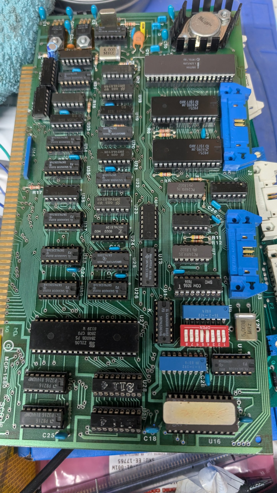
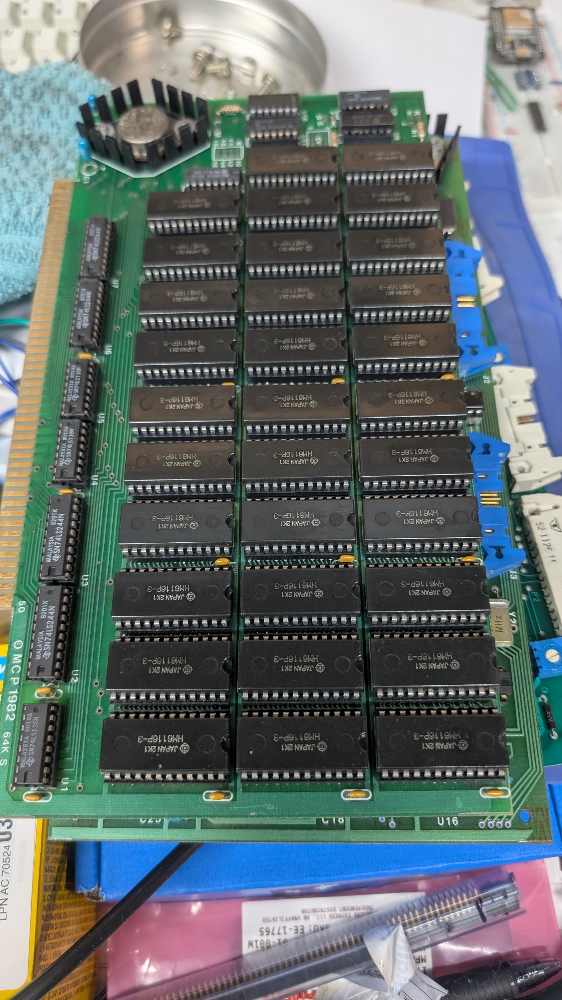
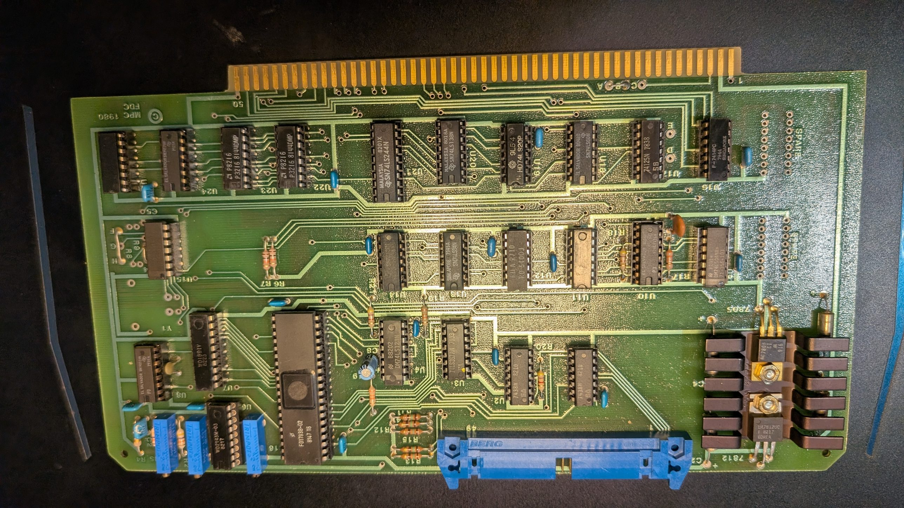

# Hardware

Identified from photos and from the boot ROM. Items marked *(tentative)*
still need checking on the hardware.

## Chassis

- Black front panel with "MCP 80/100" badge, wood side panels, keylock and a
  square push button that lights up when the machine is on (power lamp,
  probably the power switch).
- 8" floppy drive on the left.
- **MiniScribe IV model 4020** hard drive on the right (480 cylinders,
  4 heads), behind a vented panel with a red LED. See
  [../disk/README.md](../disk/README.md).
- Two serial ports on the back panel, A and B, both female DB25.
  - **A = console** (8251 at 02h/03h), 9600 baud. Needs a **null modem**
    cable to talk to a PC. A DEC VT52 terminal works well as the console.
  - **B** = the second 8251 (00h/01h), MCPMON's transfer port. Works with
    a **null modem** connection to a PC (rewired connector, believed null
    modem). Was set to 1200 baud (probably a modem or printer port
    originally); now **19200 baud** (DIP switches 1–4 all OFF).
- S-100 card cage with several cards (not all identified yet), fans,
  mains transformer, linear unregulated PSU (see
  [power-supply.md](power-supply.md)).
- A small board with three TO-3 transistors next to the floppy drive, possibly
  the regulator for the drive supply *(tentative)*. Check its outputs before
  connecting any drive.

## CPU card "MCP-1980" (board also marked SCC-6)

| Part | Notes |
|---|---|
| Zilog Z8400B PS (Z80B), date code 8139 | CPU |
| 6 MHz crystal (tall can, top) | **CPU clock: 6 MHz**, measured by FDTEST against the console UART (6000 kHz effective, so no wait states on RAM or I/O in its loops). An earlier note said MANDEL's ~11 s confirmed 4 MHz; that stopwatch timing was too rough |
| 4.000 MHz crystal | Purpose not yet known (perhaps the 8251 clocks or wait-state timing) |
| SMC COM5016 + 5.0688 MHz crystal | Dual baud-rate generator |
| 2 × AMD P8251 | Serial ports. Console at 02h/03h, second port at 00h/01h |
| Intel D8255A | Parallel I/O at 04h–07h. Port A set up as handshaked output, likely a printer port |
| MC1488 / MC1489 | RS-232 line drivers / receivers |
| 7812 / 7912 | Local ±12 V for the RS-232 drivers |
| TO-3 regulator on heatsink | Board +5 V (probably a 7805) |
| 2 × Intel P8216 | Bus transceivers |
| 2 × 2114 (U28, U29) | 1 KB static RAM at F000h–F3FFh: the monitor's scratch RAM. Confirmed independent of the memory card |
| EPROM at U16 | Original: 2716 boot monitor, label over the window (kept). Now: TMS2732A-45 with MCPMON. See [../rom/](../rom/README.md) |
| 8-position DIP switch | The COM5016's two 4-bit rate selects (OFF = 1): switches 1–4 = port B, 5–8 = port A. See table below |
| 74LS367 etc. | Bus buffers and glue logic |
| Two Berg headers (J2, J3) | Probably the serial ports |

## Memory card "MCP 1982 64K S"

- 32 × Hitachi HM6116P-3 (2K × 8 static RAM, 150 ns) = 64 KB. Static, so
  no refresh logic.
- 74LS244 buffers, 74LS138 decoders, own TO-3 regulator.
- A few small chips and what looks like a jumper header at the top. These
  could be bank-select logic, which would allow a second 64K card *(tentative)*.
- Only one memory card in this machine.

## Other cards and controllers (from the ROM)

| I/O | Device |
|---|---|
| F8h–FCh | MCP floppy controller (FD1793), see below |
| 78h–7Ch | WD179x-type floppy controller #2, same layout |
| 60h–67h | XCOMP ST/S hard disk controller (two boards). See [../disk/](../disk/README.md) |
| 0Ah | Read at reset, probably turns off the ROM copy at 0000h *(tentative)* |

Whether both floppy controller addresses exist in this machine, or the ROM
just supports two configurations, is still open.

## Floppy controller (MCP card) and 8" drive

| Part | Notes |
|---|---|
| WD FD1793B-02 | Controller, true (non-inverted) data bus. F8h command/status, F9h track, FAh sector, FBh data |
| WD2143-03 | Four-phase clock generator, as used in WD's reference designs for write precompensation |
| 3 trimmers | Data separator / precomp calibration: **don't adjust** |
| 7438 | Open-collector drivers to the drive |
| 50-pin header | Shugart SA800-style interface |
| Port FCh | Board wait port: reading it stalls the CPU until DRQ or INTRQ (bit 7 = DRQ). The ROM's boot loader uses it. Don't read it by hand |

- The ROM never writes a drive-select or density port, and the drive
  answers without one, so the card selects drive 1 by default (or the
  select is hard-wired).
- 2026-10-10: registers echo, restore/step/seek work, track 0 sensor works.
  The drive stayed NOT READY because the disk didn't turn: the spindle
  clamp's bearing was seized. Freed.

**Drive: Shugart SA850** (8", double-sided), 115 V 60 Hz, serial 041504,
logic board PCB 25140-0, 1979 date codes. Photos: `sa850-*.jpg`.

| | |
|---|---|
| Power | AC 0.35 A for the belt-driven spindle motor (pulley and belt set the 50/60 Hz speed), +24 V 1.0 A, +5 V 1.1 A |
| Index sensors | Two: tells single- from double-sided disks. READY needs 2 index holes (single-sided disk) or 3 (double-sided) |
| Single-sided disks | READY only while **side 0** is selected. Side select is pin 14; the FD1793 has no side output, so the card must leave it inactive (or drive it from a latch) |
| Factory options | DS1 plugged, terminator pack plugged (Beckman 150 Ω), S2 (side select from pin 14), IW, RS, IT, M; DS2–4, RR, RI, 2S, DC, DL, D, S1, S3 open |
| Index pulse | 1.8 ms (SA851: 0.4 ms) |

Manual: [SA850/851 OEM manual](https://retrocmp.de/fdd/shugart/851/SA850_851_Bi_OEM_Manual_1980.pdf).

8" interface signals (even pins; odd pins are ground; active low): 14 side
select, 18 head load, 20 index, 22 ready, 26/28/30/32 drive select 1–4,
34 direction, 36 step, 38 write data, 40 write gate, 42 track 00, 44 write
protect, 46 read data.
- Test program: [../tools/fdtest/](../tools/fdtest/README.md).

Note on the 2732: the part in U16 is a -45 (450 ns access). That's far too
slow for a 6 MHz Z80 without wait states, yet it runs fine, so the card
almost certainly adds wait states for ROM accesses. If random
crashes ever appear, a faster EPROM is the first thing to try.

## XCOMP ST/S hard disk controller

| Board | Marking | Notes |
|---|---|---|
| XS data board | XCOMP 001785-1, sticker 12776 | S-100 side: bus buffers (74LS244/373), microcode sequencer, 256-byte data buffer, compare buffer. 7805 regulator. One ribbon connector to the interface board |
| STS interface board | XCOMP "SA1000/ST506 INTERFACE" 001790-04, sticker 12777 | Drive side: AM26LS32 receivers, data separator (74S124 VCO, one-shots, two trimmers: don't adjust), port DIP switch (CTS 206-7) at G2, crystal, 7805. Three connectors: 34-pin control, 20-pin data, inter-board cable |

Power per the manual: data board +8 V 700 mA; interface board +8 V 500 mA,
−16 V 35 mA. Sockets cleaned and chips reseated before installing.

## Baud-rate DIP switch

Eight switches, labelled 1–8 on the board. An OFF switch reads as 1. Bits are
given as D C B A, matching the rate codes below.

| Port | Switches (D C B A) | As found | Rate |
|---|---|---|---|
| A (console) | 8 7 6 5 | off off off on = 1110 | 9600 |
| B | 4 3 2 1 | on off off off = 0111 | 1200 |

Confirmed 2026-10-10: turning switch 5 OFF moved the console to 19200.
Now set: port B at 19200 (switches 1–4 all OFF), console still 9600
(switch 5 ON, 6–8 OFF).

## COM5016 rate codes (5.0688 MHz crystal, ×16 clock)

| Code | Baud | Code | Baud |
|---|---|---|---|
| 0000 | 50 | 1000 | 1800 |
| 0001 | 75 | 1001 | 2000 |
| 0010 | 110 | 1010 | 2400 |
| 0011 | 134.5 | 1011 | 3600 |
| 0100 | 150 | 1100 | 4800 |
| 0101 | 300 | 1101 | 7200 |
| 0110 | 600 | 1110 | 9600 |
| 0111 | 1200 | 1111 | 19200 |
