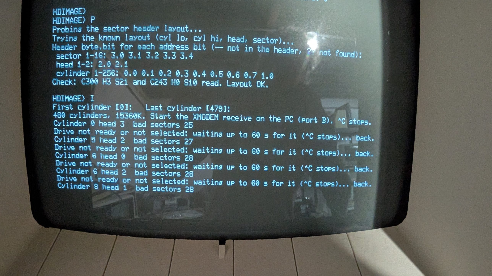

# HDIMAGE

Reads the MiniScribe 4020 through the XCOMP ST/S controller and sends it to
the PC as a disk image, by XMODEM on port B. Runs under MCPMON 2.0.

**It only reads.** The controller is set up by MCPMON's `HDINIT` (the
original ROM's microcode tables and restore), and only the read microcode
(bank 0 at D7h) is ever started. Bank 1, the write microcode, is never
touched; the simulator tests check that.

| File | |
|---|---|
| `hdimage.asm` | The program (z80asm) in two sections: 0100h–1C49h, and the T tests at 2900h–3109h; stack below 1E00h, bad list 1E00h–207Fh, CRC table and block buffer 2100h–26FFh, F's records from 3100h |
| `hdimage.hex` | For MCPMON's `H` |
| `hdfix.py` | PC side of `F`: puts the recovered sectors into the image |
| `hdmap.py` | Lists an image's bad sectors by track, head and cylinder band |
| `hdlayout.py` | Finds the CP/M logical drives and directories in an image, the block size and allocation, and which bad sectors are in files, in a directory or in free space |
| `hdmerge.py` | Fills an image's fillers from a second image of the same cylinders (a re-read of a range) |
| `hdextract.py` | Extracts the files of one logical drive from an image (`hdextract.py image.img 0 outdir`; `--list` to only list), saying per file how many of its sectors are fillers |
| `build.sh` | Builds the .hex |
| `test_hdimage.py` | Runs it in the simulator against the controller + drive model |

## Running it

1. Drive cabled to the controller, machine on, about a minute for the drive
   to spin up, recalibrate and report ready.
2. At the MCPMON prompt: `H`, send `hdimage.hex` from Tera Term on port A
   (the console), wait for `OK`, then `G:0100`.
3. It restores the drive and shows the drive status, e.g.
   `Drive status 8D selected ready track-0`.

| Key | |
|---|---|
| `P` | Check the sector header layout (and a good first read test) |
| `R` | Read one sector (cylinder, head, sector) and show it |
| `I` | Image a range of cylinders to the PC |
| `F` | Hunt for the bad sectors behind damaged IDs; fix file to the PC |
| `T` | Drive tests: spindle speed, seek patterns with every seek verified |
| `S` | Drive status |
| `Z` | Restore to cylinder 0 |
| `K` | Park the heads in the shipping zone (cylinder 525) before powering down |
| `Q` | Deselect the drive and go back to MCPMON |

### P: the header layout



Each sector header holds 4 bytes with the cylinder, head and sector. On
the MCP's MiniScribe the probe found (2026-10-12) **cylinder low, cylinder
high (bit 0), head, sector**, so `P` now tries that first: two check reads,
cylinder 300 head 3 sector 21 and cylinder 243 head 0 sector 10, which
between them set every one of the 16 address bits, so a layout with any
bit wrong fails one of them. Each has to read twice (see below). That takes
about a second:

```
Trying the known layout (cyl lo, cyl hi, head, sector)...
Header byte.bit for each address bit (-- not in the header, ?? not found):
 sector 1-16: 3.0 3.1 3.2 3.3 3.4
 head 1-2: 2.0 2.1
 cylinder 1-256: 0.0 0.1 0.2 0.3 0.4 0.5 0.6 0.7 1.0
Check: C300 H3 S21 and C243 H0 S10 read. Layout OK.
```

If that fails (another drive, another controller), the search: cylinder 0,
head 0, sector 0 is known to be `00 00 00 00` (the boot ROM reads it with
that ID), and from there the probe finds, for each address bit (sector 1,
2, 4, 8, 16; head 1, 2; cylinder 1, 2, 4 … 256), which header bit carries
it, by reading with one bit set at a time, then runs the same two check
reads. `--` means that bit isn't in the header at all (the search tests
this for the head and cylinder bits), `??` that it couldn't be found. `R`
and `I` run the probe first if it hasn't run yet.

The search's weak point is that it can only ask "does a sector with this
header exist here?", so a read that *looks* successful but isn't throws
every later bit off by one. That is what happened on the first real run:
the drive's flaky cabling (next section) produced three such reads, and
the probe reported `sector 1-16: 1.0 3.0 3.1 3.2 3.3` and a `---` for
cylinder 8, then failed its check read. Now every read the probe believes
has to succeed twice, the drive's status is checked after each read as
well as before, and the known layout is tried first anyway.

### The flaky drive

The MiniScribe's READY drops out now and then: first because of loose
cable sockets (replaced), now because its firmware loses spindle speed
lock for a moment (LED code 0111) and takes READY away until it has
locked again, every few cylinders. A read caught by a dropout can complete
with no error bits and no data, so HDIMAGE checks the drive status
(selected + ready) after every read and treats a bad one as error `80`,
like a read it couldn't start.

When that happens during `I` (or `R`), it says so and waits up to 60 s for
the drive to come back, then restores (recalibrate, seek back) and reads
the same sector again, so a short dropout costs a few seconds and nothing
in the image:

```
Drive not ready or not selected: waiting up to 60 s for it (^C stops)... back.
```

Off speed without a dropout is the subtler version. The controller finds
sectors by timing from the index pulse (its DELAYED INDEX and SECTOR
status bits), so when the spindle is a few tenths of a percent off, the
error builds up around the revolution and the last sectors of a track miss
their windows while the first ones still read: in the first full image,
tracks read during such moments lost sectors 20–31, 18–31, 29–31. So
HDIMAGE measures the index period before every track and before a failing
sector's last tries, and if it is more than 0.5 % off 16.67 ms it says so
and waits up to 15 s for it to come back:

```
Spindle off speed: 16.81 ms, waiting for it... on speed.
```

A range read again later (`I` into a second file) can then be merged into
the main image with `hdmerge.py main.img part.img first_cylinder`, which
copies only the sectors that are fillers in the main image and data in the
part, and reports any sector that reads differently in the two.

If the drive stays away the image is stopped, the PC's side cancelled, and
it says where:

```
The drive didn't come back: image stopped at cylinder 123. Whole cylinders sent: 3936K
Cut the PC's file to that size and restart the image from that cylinder.
```

The PC's file then ends somewhere inside cylinder 123; cut it to the size
given (whole cylinders) and image from 123 on into a second file, then
join the two. Tera Term itself gives up after about 100 s without a block,
which is why HDIMAGE doesn't wait longer.

### I: imaging

Asks for the first and last cylinder (Enter = 0 and 479), then waits up to
90 s for the PC.

On the PC, in the Tera Term window on port B (19200 8N1, as for XM):
**File > Transfer > XMODEM > Receive**, a file name such as
`mcp-hd-000-479.img`, option **CRC** (or 1K), **Binary** ticked.

- CRC gives 1K blocks; a checksum receiver gets 128-byte blocks.
- The VT52 shows `Cylinder 123 head 2  bad sectors 0` after each track.
- ^C or ESC on the console stops it and cancels the PC's side.
- About **21 s per cylinder**, so the whole drive (480 cylinders, 15 MB)
  takes about **2.8 hours**. To split it, image ranges into separate files
  and join them afterwards (Windows: `copy /b a.img + b.img all.img`).

The image is in cylinder, head, sector order: 32 sectors of 256 bytes per
track, 4 tracks (32K) per cylinder. In an image starting at cylinder 0,
sector C/H/S is at byte ((C × 4 + H) × 32 + S) × 256.

### Bad sectors

Each sector gets 5 reads, then 10 more: marginal sectors often come good
on a later try. Before those 10, on the first failure in a track, the drive
is recalibrated: a short move away and back, checked by reading one of
the next three sectors, and if that fails up to three restores with the
seek back, each checked the same way. Later failures in the same track
skip the recalibrate, so an unreadable track costs seconds, not minutes.
After a seek timeout or a dropout the head position counts as unknown
and the next seek restores first: in the first full image a dropout
during a recalibrate's seek moved the heads without SEEK END being seen,
and every sector to the end of that track was "not found" (the band at
cylinders 411–473, which read fine afterwards).
A sector that fails all 15 then gets 2 s and a status check: on the
MCP's drive the spindle speed drifts for a moment before the firmware
drops READY, and a sector read in that moment fails for nothing (in the
first full run the bad count went up just before each "waiting"). If READY
has dropped, the sector is read again once the drive is back; if not,
the spindle speed is checked (next section) and it gets 5 last tries. A
sector that still fails goes into the image as 8
copies of a 32-byte line, `** BAD SECTOR C123 H1 S07 **`, so it's easy to
find, and into a list printed at the end (up to 128 entries):

```
Bad sectors: 2
C1 H2 S5 err 08  C2 H0 S31 err 0A
err: 02 not found, 04 compare, 08 CRC, 40 write fault, 80 not ready, FF no answer
```

02 means the header wasn't found (the manual says the CRC bit can come
with it, 0A, when headers read badly; the real drive gives plain 02).
`80` means the drive was not ready or not selected before or after the
read, and didn't come back within the 60 s wait.

### F: sectors behind damaged IDs

On the MCP's drive every bad sector so far is a `02` on the directory
tracks: the sector's ID field, written once at format time in 1982, no
longer reads as it should, while the data field behind it (rewritten on
every file close) may be fine. `F` goes after those. For each sector in
the bad list of the last image it reads with the expected ID, then with
every single bit of it flipped, then with every value of each byte, one
read per candidate — but only candidates that keep the sector number:
a variant with another sector number can't be told from another sector,
and the first real run showed why: every track on this drive answers to
"sector 32" (a spare, or a bit the controller masks), and the hunt took
that for 44 sectors it hadn't found. So a candidate must keep the sector
field, and a hit is read again, then checked two ways: its data must not
be identical to any other sector of the track (read now), and the same
change applied to a good sector's ID must not answer too (a format
feature, not damage) — it prints `(that was sector 0)` or `(a good sector
answers to that change too: not damage)` and goes on. A sector whose ID is
gone takes about a minute to give up on; one that answers with a CRC
error in the data is kept, marked.

```
HDIMAGE> F
Hunt the 13 bad sectors of the last image (Y/N)? Y
C0 H2 S3: . found as 00 00 02 83
C0 H2 S5: ................................ not found
...
Recovered 9 sector(s).
Start the XMODEM receive on the PC (port B) for the fix file; hdfix.py puts it into the image.
```

Start the XMODEM receive (CRC, Binary) into e.g. `mcp-hd-fix.bin`, then on
the PC:

```
python3 hdfix.py mcp-hd-000-479.img mcp-hd-fix.bin
```

which replaces the fillers with the recovered sectors (a third argument
gives the first cylinder of an image that doesn't start at 0) and says
what it did. It makes the same two checks again against the image (data
identical to another sector of the track; a sector number other than the
expected one) and refuses such records, so a fix file from the earlier
build is safe to apply. The fix file is 384-byte records: 128 bytes of text, e.g.
`HDFIX C000 H2 S03 ID 00 00 02 83 OK` (or `CRC`), then the 256 data bytes.

With no list from this run (HDIMAGE was reloaded, or the list was lost),
`F` asks for the number of entries of a previous run's list: the list
lives above the program, at 1E00h, and survives a reload — type the count
the image ended with, and F checks the entries before using them. Enter
there instead asks for a single sector to hunt.

### T: drive tests

All read-only, for looking at the drive itself once the imaging is done
(it loses spindle speed lock now and then, LED code 0111):

| | | |
|---|---|---|
| `1` | Spindle | The index period, one line per 60 revolutions for N seconds (default 60): average in ms and rpm, min and max, and the number of READY drops. Nominal 16.67 ms = 3600 rpm; the resolution is 20 µs (0.12 %). A drop is waited out and counted. |
| `2` | One-cylinder walk | 0 → 479 → 0, 958 seeks |
| `3` | Full stroke | 0 ↔ 479, 50 times |
| `4` | Random | 300 random cylinders |
| `5` | Butterfly | 0, 479, 1, 478, 2, 477 … |

Every seek is timed from the command to SEEK END (0.1 ms resolution) and
verified by reading a header at the target (head 0, sector 0 or 1). A
seek that lands elsewhere is reported as it happens — `off by -1 at
C479` (the drive is then restored, to get back in step) or `lost at C123`
(nothing within ±3 cylinders) — and each pattern ends with:

```
Seeks: 958  time min/avg/max ms: 14.9/15.2/19.8
Arrived: 958  off by 1-3: 0  lost: 0  timeouts: 0  READY drops: 0
```

`off by` counts missed or extra steps (a stiff or weak stepper, a
step-pulse problem), `lost` a seek that went somewhere else entirely,
`timeouts` seeks with no SEEK END within 4 s, `READY drops` the spindle
events during the pattern. A seek to where the heads already are isn't
counted. ^C stops a test.

### K: parking

The 4020 doesn't park itself. Its firmware's own exerciser ships the heads
to position 1050 in its half-step units, cylinder 525, and refuses (by
recalibrating) anything beyond, so `K` seeks there — to 479 and then 46
more, since the seek count is 9 bits — and checks the drive didn't go to
track 0 instead. Then power the drive down; it recalibrates from there at
the next power-up. `Z` after `K` comes back to 479 first, because the
ROM's restore steps 511 at most.

## Testing

`python3 test_hdimage.py` loads it into the simulator with the timed
controller + drive model (`rom/mcpmon/xcomp.py`) and a Tera Term-like XMODEM
receiver on a 19200-baud port B (`uart8251.py`, `xmodem_peer.py`), and
checks: start-up, the known layout passing the check reads (and that those
reads set every address bit), the search on four other header layouts
(including a cylinder bit packed into the head byte and a header without
the head), `R`, imaging with CRC and checksum receivers, bad sectors (a CRC
error, a missing sector, an unformatted track), ^C, a drive that isn't
ready, and that the write microcode is never started. The flaky drive is
modelled too: a search with every fifth read a silent dud (zeros, no error)
still finds the right layout (yesterday's HDIMAGE gets it wrong in the same
way as on the real drive); three 4 s dropouts during a 3-cylinder image,
two of them in the middle of a read, leave the image intact with no bad
sectors, including one that failed its reads while the speed drifted
before the dropout; a dropout of minutes stops the image with the right
cylinder and size. For `F`: an image with five damaged IDs (a bit set in the sector
byte, in the cylinder byte, a wrong head byte, one with a CRC error in
the data too, and one ID gone) gives five `02`s; F finds four with the
IDs they answer to, never reads with another sector's ID, the fix file
arrives, `hdfix.py` puts the four back and leaves the fifth filler; and
after a reload F takes the list over by count. For `T`: the index period
reads 16.66–16.67 ms and 3600 rpm, a dropout during it is counted, the
seek patterns verify every seek, and two seeks the model lands wrong (by
−1 and +2) are reported and resynced. `K` parks at 525 and `Z` restores from
there. The spindle 1 % off for 8 s during an image: the gate waits, the
image is intact; `hdmerge.py` fills a re-read range in; a recalibrate
that lands off-track is caught by the landing check; and on a drive with
a spare "sector 32" on every track the hunt never takes it for a found
sector. 52 checks, about 5 min.

What the model couldn't know about the real controller, settled by the
first real runs (2026-10-12): seeking with the seek count works as the
manual describes (the search stepped to cylinders 1, 2, 4 … 256 and 300
and back, and the layout it found checks out), and a sector that isn't
there is reported within HDIMAGE's 150 ms allowance (the search depends on
that answer being quick and right). Still open: what the controller
actually does when the drive drops out mid-read; the model's guess (DONE
with no error bits and zeros) is the worst case, and is what the status
check after each read is for.
